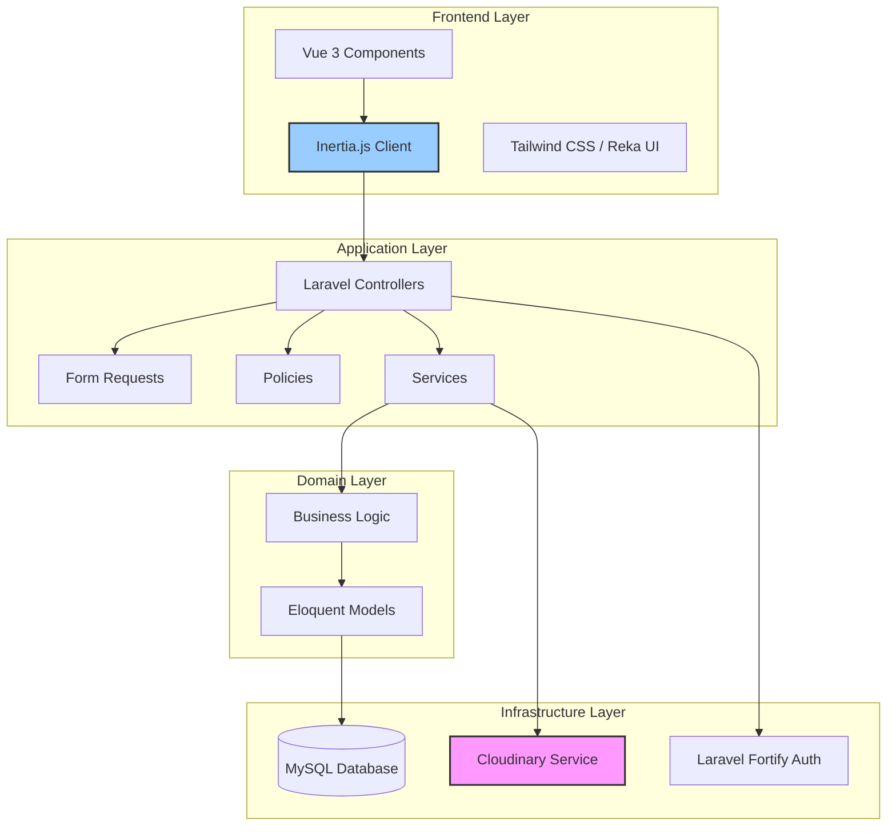

# Design Document: GRAMATECHA Presentation Platform

## Overview

GRAMATECHA is a web-based presentation platform built with Laravel 13, Vue.js 3, and Inertia.js 3 that enables administrators to upload PowerPoint presentations and users to browse and view them. The platform uses Cloudinary as its primary storage and delivery service for presentation files, leveraging Cloudinary's media optimization and delivery capabilities.

The architecture follows Laravel's MVC pattern with Vue.js components for the frontend, connected via Inertia.js for seamless SPA-like navigation. Authentication and authorization are handled by Laravel Fortify, and the user interface is styled with Tailwind CSS 4 using the Reka UI component library.

### Key Design Decisions

1. **Cloudinary for File Storage**: Rather than storing files locally or using S3, we use Cloudinary for its built-in support for document processing, delivery optimization, and CDN capabilities. Cloudinary provides auto-format and auto-quality optimizations that improve presentation delivery performance.

2. **Inertia.js for Frontend**: Maintains the simplicity of server-side routing while providing a modern SPA experience. All page data is passed as props from Laravel controllers to Vue components.

3. **Role-Based Access Control**: Simple Admin/Regular_User role system managed through a `role` column on the users table. Laravel policies enforce authorization at the controller level.

4. **Database-Driven Metadata**: Presentation metadata (title, description, file size, Cloudinary public_id) is stored in a dedicated `presentations` table, keeping file references separate from the actual files.

## Architecture

### High-Level Architecture



### Technology Stack

**Backend:**
- Laravel 13.17 (PHP 8.3)
- Laravel Fortify 1.37.2 (Authentication)
- Inertia.js Laravel Adapter 3.0
- MySQL Database

**Frontend:**
- Vue.js 3.5.13
- Inertia.js Vue3 Adapter 3.0
- Tailwind CSS 4.1.1
- Reka UI 2.9.8 (Component Library)
- VueUse 12.8.2 (Composition Utilities)
- Vue Sonner 2.0.0 (Toast Notifications)

**External Services:**
- Cloudinary 2.10.0 (npm package for client-side integration)
- Cloudinary API (for server-side upload and management)

**Testing:**
- Pest 4.7 (PHP Testing Framework)
- Pest Laravel Plugin 4.1

### Request Flow

1. **User Action**: User interacts with Vue component (e.g., clicks "Upload Presentation")
2. **Inertia Request**: Inertia intercepts and makes XHR request to Laravel route
3. **Controller Processing**: Laravel controller validates request, applies authorization policies
4. **Service Layer**: Controller delegates business logic to service classes
5. **External Integration**: Service interacts with Cloudinary API for file operations
6. **Database Persistence**: Eloquent models persist metadata to MySQL
7. **Inertia Response**: Controller returns Inertia response with component name and props
8. **Component Render**: Vue component receives props and re-renders

## Components and Interfaces

### Backend Components

#### 1. Models

**User Model** (`App\Models\User`)
```php
class User extends Authenticatable
{
    protected $fillable = ['name', 'email', 'password', 'role'];
    protected $hidden = ['password', 'remember_token'];
    protected $casts = ['email_verified_at' => 'datetime'];
    
    // Relationship
    public function presentations(): HasMany;
    
    // Role checking
    public function isAdmin(): bool;
    public function isRegularUser(): bool;
}
```

**Presentation Model** (`App\Models\Presentation`)
```php
class Presentation extends Model
{
    protected $fillable = [
        'title',
        'description',
        'filename',
        'file_size',
        'cloudinary_public_id',
        'cloudinary_url',
        'uploaded_by'
    ];
    
    protected $casts = [
        'file_size' => 'integer',
        'created_at' => 'datetime',
        'updated_at' => 'datetime',
    ];
    
    // Relationship
    public function uploader(): BelongsTo;
    
    // Helper methods
    public function getFormattedFileSize(): string;
    public function getCloudinaryViewUrl(): string;
}
```

#### 2. Controllers

**PresentationController** (`App\Http\Controllers\PresentationController`)
- `index()`: Display paginated list of presentations
- `create()`: Show upload form (admin only)
- `store(PresentationStoreRequest $request)`: Handle presentation upload
- `show(Presentation $presentation)`: Display single presentation viewer
- `edit(Presentation $presentation)`: Show edit form for metadata (admin only)
- `update(PresentationUpdateRequest $request, Presentation $presentation)`: Update metadata
- `destroy(Presentation $presentation)`: Delete presentation and file

#### 3. Form Requests

**PresentationStoreRequest** (`App\Http\Controllers\Requests\PresentationStoreRequest`)
```php
class PresentationStoreRequest extends FormRequest
{
    public function authorize(): bool;
    
    public function rules(): array
    {
        return [
            'title' => ['required', 'string', 'max:255'],
            'description' => ['nullable', 'string', 'max:1000'],
            'file' => ['required', 'file', 'mimes:ppt,pptx', 'max:51200'], // 50MB
        ];
    }
    
    public function messages(): array;
}
```

**PresentationUpdateRequest** (`App\Http\Controllers\Requests\PresentationUpdateRequest`)
```php
class PresentationUpdateRequest extends FormRequest
{
    public function authorize(): bool;
    
    public function rules(): array
    {
        return [
            'title' => ['required', 'string', 'max:255'],
            'description' => ['nullable', 'string', 'max:1000'],
        ];
    }
}
```

#### 4. Policies

**PresentationPolicy** (`App\Policies\PresentationPolicy`)
```php
class PresentationPolicy
{
    public function viewAny(User $user): bool; // All authenticated users
    public function view(User $user, Presentation $presentation): bool; // All authenticated users
    public function create(User $user): bool; // Admin only
    public function update(User $user, Presentation $presentation): bool; // Admin only
    public function delete(User $user, Presentation $presentation): bool; // Admin only
}
```

#### 5. Services

**CloudinaryService** (`App\Services\CloudinaryService`)
```php
class CloudinaryService
{
    private $cloudinary;
    
    public function __construct();
    
    public function uploadPresentation(UploadedFile $file, string $publicId): array;
    // Returns: ['public_id' => string, 'secure_url' => string, 'bytes' => int]
    
    public function deletePresentation(string $publicId): bool;
    
    public function getPresentationUrl(string $publicId): string;
    
    private function generateUniquePublicId(): string;
}
```

The CloudinaryService encapsulates all Cloudinary API interactions using the Cloudinary PHP SDK (installed via composer). It handles:
- Authentication using environment variables
- File upload to Cloudinary's document resource type
- Deletion of files from Cloudinary
- URL generation for presentation viewing

**PresentationService** (`App\Services\PresentationService`)
```php
class PresentationService
{
    public function __construct(
        private CloudinaryService $cloudinaryService
    ) {}
    
    public function createPresentation(
        UploadedFile $file,
        string $title,
        ?string $description,
        User $uploader
    ): Presentation;
    
    public function updatePresentationMetadata(
        Presentation $presentation,
        string $title,
        ?string $description
    ): Presentation;
    
    public function deletePresentation(Presentation $presentation): bool;
    
    private function scanFileForMalware(UploadedFile $file): bool;
    private function sanitizeFilename(string $filename): string;
}
```

#### 6. Middleware

**EnsureUserHasRole** (`App\Http\Middleware\EnsureUserHasRole`)
```php
class EnsureUserHasRole
{
    public function handle(Request $request, Closure $next, string $role): Response;
}
```

### Frontend Components

#### 1. Pages (Inertia Components)

**PresentationIndex.vue** (`resources/js/Pages/Presentations/Index.vue`)
- Displays paginated list of presentations
- Shows title, description, upload date, file size
- Provides links to view presentations
- Admin users see edit/delete actions
- Implements pagination controls

**PresentationCreate.vue** (`resources/js/Pages/Presentations/Create.vue`)
- Upload form with file input, title, and description
- File validation on client side (file type, size)
- Upload progress indicator
- Success/error toast notifications

**PresentationShow.vue** (`resources/js/Pages/Presentations/Show.vue`)
- Presentation viewer using Cloudinary's delivery URL
- Embeds presentation using iframe or Cloudinary's viewer widget
- Navigation controls for slides
- Back button to return to library

**PresentationEdit.vue** (`resources/js/Pages/Presentations/Edit.vue`)
- Form for editing title and description
- Shows current values
- Success/error toast notifications

#### 2. Shared Components

**PresentationCard.vue** (`resources/js/Components/PresentationCard.vue`)
```vue
<script setup lang="ts">
interface Props {
  presentation: {
    id: number
    title: string
    description: string | null
    file_size: string
    created_at: string
    cloudinary_url: string
  }
  canManage: boolean
}

const props = defineProps<Props>()
const emit = defineEmits<{
  delete: [id: number]
}>()
</script>
```

**PresentationViewer.vue** (`resources/js/Components/PresentationViewer.vue`)
```vue
<script setup lang="ts">
interface Props {
  cloudinaryPublicId: string
  title: string
}

const props = defineProps<Props>()

// Uses Cloudinary's delivery URL with auto-format and auto-quality
const presentationUrl = computed(() => {
  return `https://res.cloudinary.com/${cloudinaryCloudName}/image/upload/f_auto,q_auto/${props.cloudinaryPublicId}`
})
</script>
```

**UploadProgress.vue** (`resources/js/Components/UploadProgress.vue`)
- Progress bar component
- Shows upload percentage
- Cancellation support (optional)

**DeleteConfirmationDialog.vue** (`resources/js/Components/DeleteConfirmationDialog.vue`)
- Confirmation dialog for destructive actions
- Uses Reka UI Dialog component
- Accepts presentation title as prop

### Database Schema

#### Users Table
```sql
CREATE TABLE users (
    id BIGINT UNSIGNED AUTO_INCREMENT PRIMARY KEY,
    name VARCHAR(255) NOT NULL,
    email VARCHAR(255) UNIQUE NOT NULL,
    email_verified_at TIMESTAMP NULL,
    password VARCHAR(255) NOT NULL,
    role ENUM('admin', 'regular_user') NOT NULL DEFAULT 'regular_user',
    remember_token VARCHAR(100) NULL,
    created_at TIMESTAMP NULL,
    updated_at TIMESTAMP NULL,
    INDEX idx_role (role)
);
```

#### Presentations Table
```sql
CREATE TABLE presentations (
    id BIGINT UNSIGNED AUTO_INCREMENT PRIMARY KEY,
    title VARCHAR(255) NOT NULL,
    description TEXT NULL,
    filename VARCHAR(255) NOT NULL,
    file_size BIGINT UNSIGNED NOT NULL,
    cloudinary_public_id VARCHAR(255) UNIQUE NOT NULL,
    cloudinary_url TEXT NOT NULL,
    uploaded_by BIGINT UNSIGNED NOT NULL,
    created_at TIMESTAMP NULL,
    updated_at TIMESTAMP NULL,
    
    FOREIGN KEY (uploaded_by) REFERENCES users(id) ON DELETE CASCADE,
    INDEX idx_uploaded_by (uploaded_by),
    INDEX idx_created_at (created_at),
    INDEX idx_cloudinary_public_id (cloudinary_public_id)
);
```

## Data Models

### User Data Model

```typescript
interface User {
  id: number
  name: string
  email: string
  email_verified_at: string | null
  role: 'admin' | 'regular_user'
  created_at: string
  updated_at: string
}
```

### Presentation Data Model

```typescript
interface Presentation {
  id: number
  title: string
  description: string | null
  filename: string
  file_size: number // bytes
  file_size_formatted: string // e.g., "2.5 MB"
  cloudinary_public_id: string
  cloudinary_url: string
  uploaded_by: number
  uploader?: User // May be included via relationship
  created_at: string
  updated_at: string
}
```

### Paginated Presentation Response

```typescript
interface PaginatedPresentations {
  data: Presentation[]
  current_page: number
  last_page: number
  per_page: number
  total: number
  from: number
  to: number
  links: PaginationLink[]
}

interface PaginationLink {
  url: string | null
  label: string
  active: boolean
}
```

### Upload Request Data

```typescript
interface PresentationUploadData {
  title: string
  description?: string
  file: File
}
```

### Update Request Data

```typescript
interface PresentationUpdateData {
  title: string
  description?: string
}
```

## Cloudinary Integration

### Configuration

Cloudinary configuration is loaded from environment variables:

```php
// config/services.php
return [
    'cloudinary' => [
        'cloud_name' => env('CLOUDINARY_CLOUD_NAME', 'io7qeps0'),
        'api_key' => env('CLOUDINARY_API_KEY', '975981621953623'),
        'api_secret' => env('CLOUDINARY_API_SECRET'),
    ],
];
```

### Upload Process

1. **Validate File**: Check MIME type (ppt, pptx) and size (<= 50MB)
2. **Sanitize Filename**: Remove special characters, prevent path traversal
3. **Generate Public ID**: Create unique identifier (e.g., `presentations/{uuid}`)
4. **Upload to Cloudinary**: Use Cloudinary SDK to upload with `resource_type: 'raw'` for PPTX files
5. **Store Metadata**: Save public_id, secure_url, file_size to database
6. **Return Success**: Redirect with success message

### Cloudinary Upload Configuration

```php
$uploadResult = $this->cloudinary->uploadApi()->upload(
    $file->getRealPath(),
    [
        'public_id' => $publicId,
        'resource_type' => 'raw', // For non-image files
        'folder' => 'presentations',
        'use_filename' => false,
        'unique_filename' => true,
    ]
);
```

### Viewing Presentations

For viewing, we use Cloudinary's delivery URLs with optimization parameters:

```
https://res.cloudinary.com/{cloud_name}/image/upload/f_auto,q_auto/{public_id}
```

However, since PPTX files are raw documents, we'll use Cloudinary's URL to download or embed the file directly. For better viewing experience, we may use:

1. **Direct Download Link**: Users download and open in PowerPoint
2. **Office Online Viewer**: Embed using Microsoft's viewer if PPTX is accessible
3. **Cloudinary Document Pages**: Convert PPTX pages to images for web viewing

**Recommended Approach**: Convert PPTX to images on upload using Cloudinary transformations, then display as image gallery with navigation.

### Deletion Process

1. **Verify Permissions**: Ensure user is admin
2. **Delete from Cloudinary**: Call Cloudinary API to remove file
3. **Delete Database Record**: Remove presentation metadata
4. **Handle Errors**: Log if Cloudinary deletion fails, but still remove from database

## Error Handling

### Backend Error Handling

#### 1. File Upload Errors

```php
try {
    $uploadResult = $cloudinaryService->uploadPresentation($file, $publicId);
} catch (CloudinaryException $e) {
    Log::error('Cloudinary upload failed', [
        'error' => $e->getMessage(),
        'file' => $file->getClientOriginalName(),
    ]);
    
    throw new PresentationUploadException(
        'Failed to upload presentation. Please try again later.'
    );
}
```

#### 2. Validation Errors

Laravel's FormRequest handles validation errors automatically, returning JSON responses with 422 status code for Inertia requests.

#### 3. Authorization Errors

```php
// In controller
$this->authorize('create', Presentation::class);

// If fails, throws AuthorizationException
// Handled by Laravel's exception handler
// Returns 403 response
```

#### 4. File Not Found Errors

```php
public function show(Presentation $presentation)
{
    // Model binding handles 404 if presentation doesn't exist
    
    // Verify file exists in Cloudinary
    if (!$this->cloudinaryService->fileExists($presentation->cloudinary_public_id)) {
        Log::warning('Presentation file not found in Cloudinary', [
            'presentation_id' => $presentation->id,
            'public_id' => $presentation->cloudinary_public_id,
        ]);
        
        abort(404, 'Presentation file not found.');
    }
    
    return Inertia::render('Presentations/Show', [
        'presentation' => $presentation,
    ]);
}
```

#### 5. Malware Scan Errors

```php
private function scanFileForMalware(UploadedFile $file): bool
{
    // Option 1: Use ClamAV or similar service
    // Option 2: Use cloud-based service (VirusTotal API)
    // Option 3: Basic file signature validation
    
    try {
        // Implement malware scanning
        $scanner = new MalwareScanner();
        $result = $scanner->scan($file->getRealPath());
        
        if (!$result->isClean()) {
            Log::warning('Malware detected in upload', [
                'filename' => $file->getClientOriginalName(),
                'threats' => $result->getThreats(),
            ]);
            return false;
        }
        
        return true;
    } catch (Exception $e) {
        Log::error('Malware scan failed', [
            'error' => $e->getMessage(),
        ]);
        
        // Fail closed: reject if scan fails
        return false;
    }
}
```

### Frontend Error Handling

#### 1. Upload Errors

```typescript
const handleUpload = async (data: PresentationUploadData) => {
  try {
    await router.post('/presentations', data, {
      onProgress: (progress) => {
        uploadProgress.value = progress.percentage
      },
      onSuccess: () => {
        toast.success('Presentation uploaded successfully!')
      },
      onError: (errors) => {
        if (errors.file) {
          toast.error(errors.file)
        } else {
          toast.error('Failed to upload presentation. Please try again.')
        }
      },
    })
  } catch (error) {
    toast.error('An unexpected error occurred.')
    console.error('Upload error:', error)
  }
}
```

#### 2. Network Errors

```typescript
// Inertia handles network errors automatically
// We can add global error handling in app setup

app.config.errorHandler = (err, instance, info) => {
  console.error('Global error:', err, info)
  
  if (axios.isAxiosError(err)) {
    if (err.code === 'ERR_NETWORK') {
      toast.error('Network error. Please check your connection.')
    } else if (err.response?.status === 500) {
      toast.error('Server error. Please try again later.')
    }
  }
}
```

#### 3. Validation Errors

```vue
<script setup lang="ts">
import { useForm } from '@inertiajs/vue3'

const form = useForm({
  title: '',
  description: '',
  file: null,
})

const submit = () => {
  form.post('/presentations', {
    onError: () => {
      // Form.errors contains field-specific validation messages
      // Inertia automatically binds these to form fields
    }
  })
}
</script>

<template>
  <input v-model="form.title" />
  <span v-if="form.errors.title" class="text-red-500">
    {{ form.errors.title }}
  </span>
</template>
```

## Testing Strategy

### Backend Testing

#### Unit Tests

Unit tests focus on isolated components and business logic:

1. **Model Tests**
   - Test User role checking methods (isAdmin, isRegularUser)
   - Test Presentation helper methods (getFormattedFileSize, getCloudinaryViewUrl)
   - Test model relationships

2. **Service Tests**
   - Test CloudinaryService with mocked Cloudinary API
   - Test PresentationService business logic
   - Test filename sanitization
   - Test malware scanning logic

3. **Policy Tests**
   - Test authorization rules for each action
   - Test admin vs regular user permissions

4. **Form Request Tests**
   - Test validation rules
   - Test custom validation messages
   - Test authorization methods

#### Integration Tests

Integration tests verify components working together:

1. **Presentation Upload Flow**
   - Test successful upload with valid file
   - Test rejection of invalid file types
   - Test rejection of oversized files
   - Test metadata storage in database

2. **Presentation Viewing Flow**
   - Test authenticated users can view presentations
   - Test presentation viewer loads correct data

3. **Presentation Deletion Flow**
   - Test admin can delete presentation
   - Test regular user cannot delete presentation
   - Test Cloudinary file is removed

4. **Authentication Flow**
   - Test user registration
   - Test user login
   - Test role assignment

### Frontend Testing

#### Component Tests

1. **PresentationCard Tests**
   - Test rendering of presentation data
   - Test admin action buttons visibility
   - Test delete event emission

2. **PresentationViewer Tests**
   - Test Cloudinary URL generation
   - Test viewer rendering

3. **Upload Form Tests**
   - Test file validation
   - Test form submission
   - Test error display

#### E2E Tests (Optional)

End-to-end tests using Laravel Dusk or Cypress:

1. Complete upload flow from login to viewing
2. Pagination navigation
3. Presentation deletion workflow

### Test Coverage Goals

- Unit Tests: 80%+ coverage of service and business logic
- Integration Tests: All major user flows covered
- Component Tests: All reusable components tested

### Test Data

Use Laravel factories for generating test data:

```php
// database/factories/PresentationFactory.php
class PresentationFactory extends Factory
{
    public function definition(): array
    {
        return [
            'title' => fake()->sentence(),
            'description' => fake()->paragraph(),
            'filename' => fake()->word() . '.pptx',
            'file_size' => fake()->numberBetween(100000, 50000000),
            'cloudinary_public_id' => 'presentations/' . fake()->uuid(),
            'cloudinary_url' => fake()->url(),
            'uploaded_by' => User::factory(),
        ];
    }
}
```

### Testing Cloudinary Integration

For testing Cloudinary integration, use mocking to avoid actual API calls:

```php
// In tests
$cloudinaryMock = Mockery::mock(CloudinaryService::class);
$cloudinaryMock->shouldReceive('uploadPresentation')
    ->once()
    ->andReturn([
        'public_id' => 'test_public_id',
        'secure_url' => 'https://cloudinary.test/file.pptx',
        'bytes' => 1000000,
    ]);

$this->app->instance(CloudinaryService::class, $cloudinaryMock);
```

For integration tests that actually test Cloudinary, use a test-specific Cloudinary account or folder to avoid polluting production data.


## Correctness Properties

*A property is a characteristic or behavior that should hold true across all valid executions of a system—essentially, a formal statement about what the system should do. Properties serve as the bridge between human-readable specifications and machine-verifiable correctness guarantees.*

### Property Reflection

After analyzing all acceptance criteria, I identified the following properties suitable for property-based testing. I performed reflection to eliminate redundancies:

**Redundancies Identified:**
- Properties 1.4 and 1.5 (authorization enforcement) can be combined into a single comprehensive property
- Properties 2.7 and 3.3 (metadata persistence) test the same behavior
- Properties 4.4 and 4.5 (pagination) can be combined
- Properties 2.8 and 8.2 (ID uniqueness) are identical
- Properties 5.3 and 8.3 (public_id usage) are identical

**Final Property Set:**
After reflection, 11 unique correctness properties remain that provide comprehensive validation coverage.

### Property 1: Authorization Enforcement

*For any* user without admin role and *for any* admin-protected route, attempting to access that route SHALL result in authorization denial with a 403 error response.

**Validates: Requirements 1.4, 1.5**

### Property 2: File Type Validation

*For any* uploaded file, if the file's MIME type is not in ['application/vnd.ms-powerpoint', 'application/vnd.openxmlformats-officedocument.presentationml.presentation'] OR the file extension is not in ['.ppt', '.pptx'], THEN the validation SHALL fail with a descriptive error message.

**Validates: Requirements 2.2, 2.3**

### Property 3: File Size Validation

*For any* uploaded file, if the file size is less than or equal to 52,428,800 bytes (50MB), THEN size validation SHALL pass; if the file size exceeds 52,428,800 bytes, THEN size validation SHALL fail with a file size error message.

**Validates: Requirements 2.5, 2.6**

### Property 4: Metadata Persistence

*For any* successfully uploaded presentation, the System SHALL persist all required metadata fields (title, description, filename, file_size, cloudinary_public_id, cloudinary_url, uploaded_by, created_at) in the database, and retrieving the presentation SHALL return all persisted fields accurately.

**Validates: Requirements 2.7, 3.3**

### Property 5: Unique Identifier Generation

*For any* set of N presentation uploads (where N >= 2), all generated presentation IDs SHALL be unique with no collisions, and all generated Cloudinary public_id values SHALL be unique with no collisions.

**Validates: Requirements 2.8, 8.2**

### Property 6: Description Length Validation

*For any* description string, if the string length is less than or equal to 1000 characters, THEN validation SHALL pass; if the string length exceeds 1000 characters, THEN validation SHALL fail with a length error message.

**Validates: Requirements 3.2**

### Property 7: Presentation Listing Completeness

*For any* set of presentations in the database, querying the presentation library SHALL return all presentations in the result set (across all pages if paginated), with each presentation including its title, description, upload_date, and file_size.

**Validates: Requirements 4.1, 4.2**

### Property 8: Presentation Sorting Order

*For any* list of presentations returned by the System, the presentations SHALL be ordered by created_at timestamp in descending order (newest first), such that for all adjacent pairs (presentation_i, presentation_{i+1}), presentation_i.created_at >= presentation_{i+1}.created_at.

**Validates: Requirements 4.3**

### Property 9: Pagination Logic

*For any* total count of presentations, if the count is greater than 20, THEN the System SHALL apply pagination with exactly 20 items per page; if the count is less than or equal to 20, THEN pagination SHALL not be applied and all presentations SHALL appear on a single page.

**Validates: Requirements 4.4, 4.5**

### Property 10: Cloudinary URL Generation

*For any* presentation with a stored cloudinary_public_id, generating a viewer URL SHALL produce a valid Cloudinary URL containing the public_id and optimization parameters (f_auto, q_auto).

**Validates: Requirements 5.3, 5.7, 8.3**

### Property 11: Presentation Deletion Completeness

*For any* presentation, after a successful deletion operation, the presentation record SHALL not exist in the database (queries for that ID SHALL return null), and the presentation SHALL not appear in any presentation library queries.

**Validates: Requirements 6.4**

### Property 12: Filename Sanitization

*For any* input filename containing path traversal patterns (including but not limited to: '../', '..\\', absolute paths starting with '/' or drive letters), the sanitization function SHALL remove or neutralize these patterns, producing a safe filename that contains only alphanumeric characters, hyphens, underscores, and a single file extension.

**Validates: Requirements 10.2**

### Property 13: Malware Detection

*For any* uploaded file, if the file contains known malware signatures or suspicious patterns as determined by the malware scanner, THEN the upload SHALL be rejected with an appropriate error message; if the file is clean, THEN the upload SHALL proceed.

**Validates: Requirements 10.3, 10.4**


## Security Considerations

### Authentication and Session Security

1. **Password Hashing**: Laravel Fortify uses bcrypt by default for password hashing (cost factor 12)
2. **Session Security**: 
   - Sessions use HTTP-only cookies to prevent XSS attacks
   - CSRF tokens protect all state-changing operations
   - Session lifetime configured in `config/session.php`

3. **Rate Limiting**: Apply rate limiting to authentication endpoints:
   ```php
   // In routes/web.php
   Route::middleware(['throttle:login'])->group(function () {
       // Fortify routes
   });
   ```

### File Upload Security

1. **MIME Type Validation**: Server-side validation of file MIME types using Laravel's validation rules
2. **File Size Limits**: 
   - PHP `upload_max_filesize` set to 50MB
   - PHP `post_max_size` set to 52MB (slightly higher to account for other form data)
   - Laravel validation enforces 50MB limit

3. **Filename Sanitization**: Remove/escape special characters and path traversal patterns:
   ```php
   private function sanitizeFilename(string $filename): string
   {
       // Remove path separators
       $filename = basename($filename);
       
       // Remove null bytes
       $filename = str_replace(chr(0), '', $filename);
       
       // Keep only safe characters
       $filename = preg_replace('/[^a-zA-Z0-9_\-\.]/', '_', $filename);
       
       // Prevent double extensions
       $filename = preg_replace('/\.+/', '.', $filename);
       
       return $filename;
   }
   ```

4. **Malware Scanning**: Integrate ClamAV or cloud-based scanning service:
   ```php
   // Option 1: ClamAV (requires ClamAV installed on server)
   use Xenolope\Quahog\Client;
   
   private function scanFileForMalware(UploadedFile $file): bool
   {
       $socket = new Client('unix:///var/run/clamav/clamd.socket', 3000, PHP_NORMAL_READ);
       $result = $socket->scanFile($file->getRealPath());
       
       return $result['status'] === 'OK';
   }
   
   // Option 2: Cloud-based scanning (VirusTotal, MetaDefender)
   // Implement API integration based on chosen service
   ```

5. **Cloudinary Security**:
   - API credentials stored in environment variables, never in code
   - Use signed URLs for sensitive content (if needed in future)
   - Restrict upload permissions to specific folders

### Authorization Security

1. **Policy-Based Authorization**: All admin actions protected by Laravel policies
2. **Middleware Protection**: Stack authorization middleware on routes:
   ```php
   Route::middleware(['auth', 'verified'])->group(function () {
       Route::resource('presentations', PresentationController::class);
   });
   ```

3. **Role Validation**: Validate roles at multiple layers:
   - Middleware for route-level protection
   - Policies for model-level authorization
   - View-level checks for conditional rendering

### Data Security

1. **SQL Injection Prevention**: Always use Eloquent ORM or query builder with parameter binding
2. **XSS Prevention**: 
   - Vue.js automatically escapes template expressions
   - Use `v-html` only with sanitized content
   - Laravel Blade escapes `{{ }}` expressions automatically

3. **CSRF Protection**: Laravel's CSRF middleware enabled for all POST/PUT/DELETE requests
4. **Mass Assignment Protection**: Define `$fillable` or `$guarded` on all models

### Cloudinary API Security

1. **Credential Management**:
   ```env
   CLOUDINARY_CLOUD_NAME=io7qeps0
   CLOUDINARY_API_KEY=975981621953623
   CLOUDINARY_API_SECRET=<secret_value>
   ```

2. **Server-Side Operations**: All upload/delete operations happen server-side to protect API credentials
3. **Access Control**: Configure Cloudinary upload presets with appropriate restrictions

## Implementation Guidelines

### Development Setup

1. **Environment Configuration**:
   ```bash
   # Copy environment file
   cp .env.example .env
   
   # Set database connection
   DB_CONNECTION=mysql
   DB_DATABASE=gramatecha
   
   # Configure Cloudinary
   CLOUDINARY_CLOUD_NAME=io7qeps0
   CLOUDINARY_API_KEY=975981621953623
   CLOUDINARY_API_SECRET=your_secret_here
   ```

2. **Install Dependencies**:
   ```bash
   composer install
   npm install
   ```

3. **Generate Application Key**:
   ```bash
   php artisan key:generate
   ```

4. **Run Migrations**:
   ```bash
   php artisan migrate
   ```

5. **Seed Admin User** (optional):
   ```bash
   php artisan db:seed --class=AdminUserSeeder
   ```

### Coding Standards

1. **PHP**: Follow PSR-12 coding standards, enforced by Laravel Pint
2. **TypeScript/Vue**: Use ESLint with Vue plugin, Prettier for formatting
3. **Naming Conventions**:
   - Controllers: Singular name + `Controller` (e.g., `PresentationController`)
   - Models: Singular name (e.g., `Presentation`)
   - Views: Plural folder name (e.g., `Presentations/Index.vue`)
   - Routes: RESTful resource naming

### Database Migrations

Create migrations in order:

1. **Add role to users table**:
   ```php
   public function up(): void
   {
       Schema::table('users', function (Blueprint $table) {
           $table->enum('role', ['admin', 'regular_user'])
                 ->default('regular_user')
                 ->after('password');
           $table->index('role');
       });
   }
   ```

2. **Create presentations table**:
   ```php
   public function up(): void
   {
       Schema::create('presentations', function (Blueprint $table) {
           $table->id();
           $table->string('title');
           $table->text('description')->nullable();
           $table->string('filename');
           $table->unsignedBigInteger('file_size');
           $table->string('cloudinary_public_id')->unique();
           $table->text('cloudinary_url');
           $table->foreignId('uploaded_by')
                 ->constrained('users')
                 ->onDelete('cascade');
           $table->timestamps();
           
           $table->index('uploaded_by');
           $table->index('created_at');
           $table->index('cloudinary_public_id');
       });
   }
   ```

### Route Organization

```php
// routes/web.php

use App\Http\Controllers\PresentationController;

// Public routes
Route::get('/', function () {
    return redirect()->route('presentations.index');
});

// Authenticated routes
Route::middleware(['auth', 'verified'])->group(function () {
    // Presentations - all authenticated users can view
    Route::get('/presentations', [PresentationController::class, 'index'])
        ->name('presentations.index');
    
    Route::get('/presentations/{presentation}', [PresentationController::class, 'show'])
        ->name('presentations.show');
    
    // Admin-only routes
    Route::middleware(['can:create,App\Models\Presentation'])->group(function () {
        Route::get('/presentations/create', [PresentationController::class, 'create'])
            ->name('presentations.create');
        
        Route::post('/presentations', [PresentationController::class, 'store'])
            ->name('presentations.store');
    });
    
    Route::middleware(['can:update,presentation'])->group(function () {
        Route::get('/presentations/{presentation}/edit', [PresentationController::class, 'edit'])
            ->name('presentations.edit');
        
        Route::put('/presentations/{presentation}', [PresentationController::class, 'update'])
            ->name('presentations.update');
    });
    
    Route::delete('/presentations/{presentation}', [PresentationController::class, 'destroy'])
        ->middleware('can:delete,presentation')
        ->name('presentations.destroy');
});
```

### Service Provider Registration

```php
// app/Providers/AppServiceProvider.php

public function register(): void
{
    $this->app->singleton(CloudinaryService::class, function ($app) {
        return new CloudinaryService(
            config('services.cloudinary.cloud_name'),
            config('services.cloudinary.api_key'),
            config('services.cloudinary.api_secret')
        );
    });
}
```

### Frontend Component Structure

```
resources/js/
├── Components/
│   ├── PresentationCard.vue
│   ├── PresentationViewer.vue
│   ├── UploadProgress.vue
│   ├── DeleteConfirmationDialog.vue
│   └── ui/
│       ├── Button.vue
│       ├── Card.vue
│       ├── Dialog.vue
│       └── ... (Reka UI components)
├── Layouts/
│   ├── AppLayout.vue
│   └── GuestLayout.vue
├── Pages/
│   ├── Auth/
│   │   ├── Login.vue
│   │   ├── Register.vue
│   │   └── ForgotPassword.vue
│   └── Presentations/
│       ├── Index.vue
│       ├── Show.vue
│       ├── Create.vue
│       └── Edit.vue
└── app.ts
```

### Type Definitions

Create shared TypeScript types:

```typescript
// resources/js/types/index.ts

export interface User {
  id: number
  name: string
  email: string
  email_verified_at: string | null
  role: 'admin' | 'regular_user'
  created_at: string
  updated_at: string
}

export interface Presentation {
  id: number
  title: string
  description: string | null
  filename: string
  file_size: number
  file_size_formatted: string
  cloudinary_public_id: string
  cloudinary_url: string
  uploaded_by: number
  uploader?: User
  created_at: string
  updated_at: string
}

export interface PaginatedResponse<T> {
  data: T[]
  current_page: number
  last_page: number
  per_page: number
  total: number
  from: number
  to: number
  links: PaginationLink[]
}

export interface PaginationLink {
  url: string | null
  label: string
  active: boolean
}

export interface PageProps {
  auth: {
    user: User
  }
  flash: {
    success?: string
    error?: string
  }
}
```

## Performance Optimization

### Backend Optimization

1. **Database Query Optimization**:
   - Use eager loading for relationships: `Presentation::with('uploader')->paginate(20)`
   - Add database indexes on frequently queried columns (role, created_at, cloudinary_public_id)
   - Use Laravel's query caching for presentation listings

2. **File Upload Optimization**:
   - Stream file uploads directly to Cloudinary without storing temporarily
   - Use chunked uploads for large files
   - Implement upload queue for asynchronous processing

3. **Caching Strategy**:
   ```php
   // Cache presentation library for 5 minutes
   Cache::remember('presentations.page.' . $page, 300, function () use ($page) {
       return Presentation::with('uploader')
           ->latest()
           ->paginate(20, ['*'], 'page', $page);
   });
   
   // Clear cache on create/update/delete
   Cache::tags(['presentations'])->flush();
   ```

### Frontend Optimization

1. **Code Splitting**: Lazy load presentation viewer component:
   ```typescript
   const PresentationViewer = defineAsyncComponent(() => 
     import('./Components/PresentationViewer.vue')
   )
   ```

2. **Image Optimization**: Use Cloudinary's automatic format and quality optimization
3. **Prefetching**: Prefetch presentation data on card hover:
   ```vue
   <a 
     :href="route('presentations.show', presentation.id)"
     @mouseenter="prefetchPresentation(presentation.id)"
   >
   ```

4. **Virtual Scrolling**: For very long presentation lists, implement virtual scrolling to render only visible items

### Cloudinary Optimization

1. **Responsive Images**: Use Cloudinary transformations for different screen sizes:
   ```
   https://res.cloudinary.com/{cloud_name}/image/upload/w_auto,dpr_auto,f_auto,q_auto/{public_id}
   ```

2. **Lazy Loading**: Implement lazy loading for presentation thumbnails
3. **CDN Caching**: Configure appropriate cache headers for Cloudinary resources

## Monitoring and Logging

### Application Logging

1. **Log Channels**: Configure separate channels for different concerns:
   ```php
   // config/logging.php
   'channels' => [
       'cloudinary' => [
           'driver' => 'daily',
           'path' => storage_path('logs/cloudinary.log'),
           'level' => 'info',
       ],
       'uploads' => [
           'driver' => 'daily',
           'path' => storage_path('logs/uploads.log'),
           'level' => 'info',
       ],
   ],
   ```

2. **Event Logging**: Log important events:
   ```php
   Log::channel('uploads')->info('Presentation uploaded', [
       'presentation_id' => $presentation->id,
       'user_id' => $user->id,
       'file_size' => $presentation->file_size,
       'cloudinary_public_id' => $presentation->cloudinary_public_id,
   ]);
   ```

### Error Tracking

Integrate error tracking service (Sentry, Bugsnag):

```php
// config/logging.php
'sentry' => [
    'driver' => 'sentry',
    'level' => 'error',
],
```

### Performance Monitoring

1. **Laravel Telescope**: Install for development environment monitoring
2. **Query Performance**: Monitor slow queries using Laravel Debugbar
3. **Cloudinary Analytics**: Review Cloudinary dashboard for usage and performance metrics

## Deployment Considerations

### Environment Requirements

- PHP 8.3 or higher
- MySQL 8.0 or higher (or compatible database)
- Node.js 18 or higher
- Composer 2.0 or higher
- Cloudinary account with API credentials

### Production Configuration

1. **Environment Variables**:
   ```env
   APP_ENV=production
   APP_DEBUG=false
   APP_URL=https://gramatecha.com
   
   DB_CONNECTION=mysql
   DB_HOST=production-db-host
   DB_DATABASE=gramatecha_production
   
   CLOUDINARY_CLOUD_NAME=io7qeps0
   CLOUDINARY_API_KEY=975981621953623
   CLOUDINARY_API_SECRET=<production_secret>
   
   CACHE_DRIVER=redis
   QUEUE_CONNECTION=redis
   SESSION_DRIVER=redis
   ```

2. **Optimization Commands**:
   ```bash
   php artisan config:cache
   php artisan route:cache
   php artisan view:cache
   npm run build
   ```

3. **Queue Workers**: Run queue workers for asynchronous upload processing:
   ```bash
   php artisan queue:work --tries=3 --timeout=300
   ```

### Backup Strategy

1. **Database Backups**: Daily automated backups of MySQL database
2. **Cloudinary Backups**: Cloudinary maintains redundant storage; configure backup addon if needed
3. **Code Repository**: Maintain version control with Git

### Scaling Considerations

1. **Horizontal Scaling**: Application is stateless and can scale horizontally behind load balancer
2. **Database Scaling**: Consider read replicas for presentation listings
3. **Session Storage**: Use Redis for shared session storage across multiple servers
4. **File Storage**: Cloudinary handles CDN and scaling automatically

